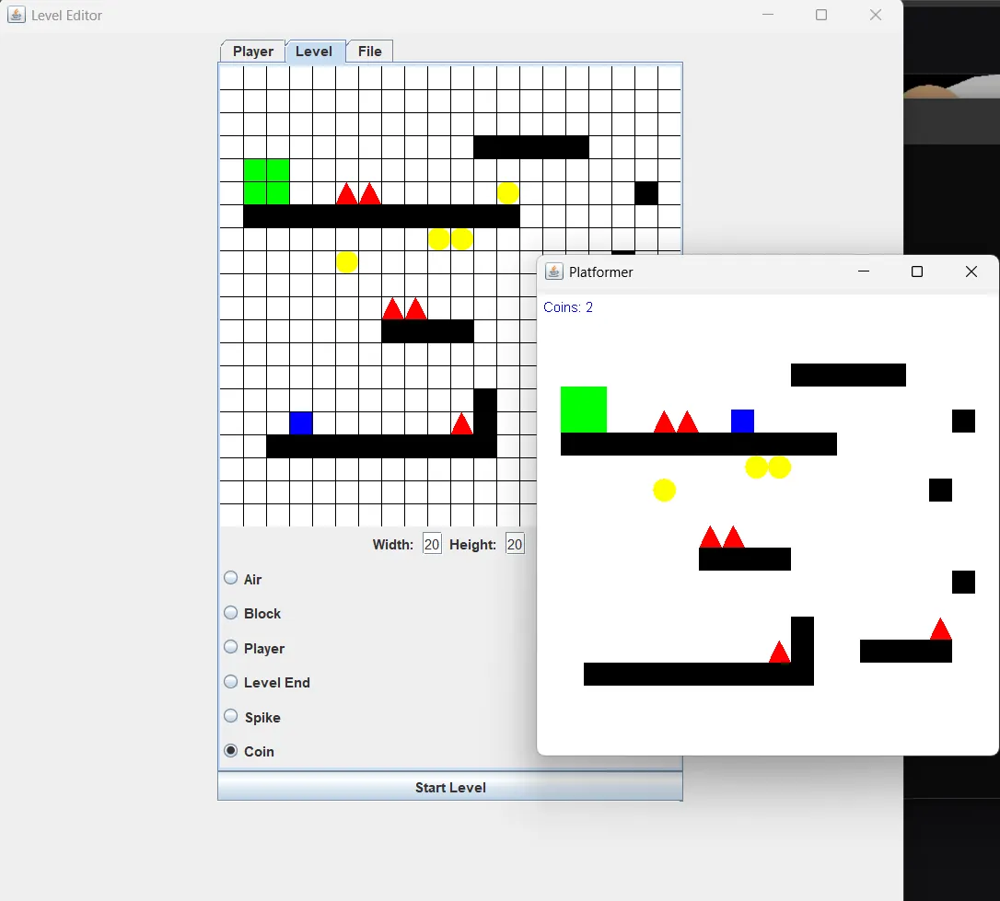
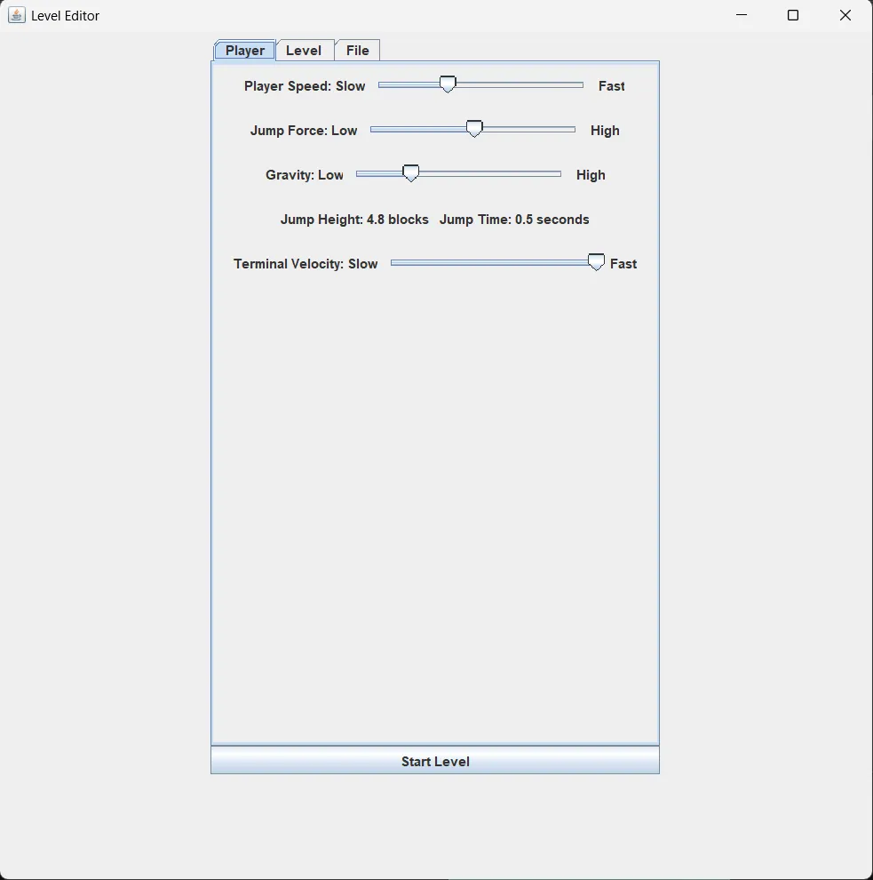
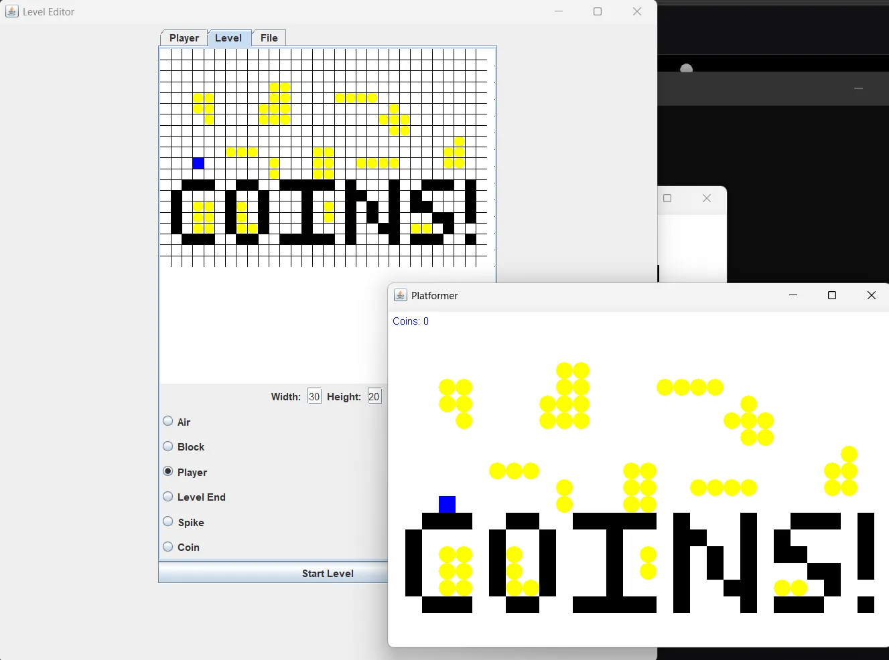

# Build Your Own Platformer!

A platformer level editor and game in Java (Swing). Draw a level on a grid, tune how the player moves, then jump straight into playing it. Built solo as my final project for Yale's CPSC 1001 (Introduction to Programming).



## How it works

On launch, the program opens a level creation menu, used with mouse and keyboard. Drag sliders, type in text fields, click buttons, and draw on the grid to build your level. Clicking **Start Level** opens a new window where you play it with the keyboard. (No audio.)

What a level's goal is depends on the creator: reach the end of the level, collect coins, or anything in between, all without falling off the level or touching spikes.

Levels can be saved to and loaded from text files, so they can be shared with friends or used as a quick tool for sketching platformer level and player designs.

### Editor features
- Place and erase blocks, spikes, coins, the level end, and the player spawn
- Resize the level grid
- Tune walk speed, jump force, gravity, and terminal velocity
- Save and load levels as `.txt` files

<p>
  
  
</p>

### Controls
| Key | Action |
|---|---|
| A | Walk left |
| D | Walk right |
| Space | Jump |

## Running it

Requires a Java JDK. From this folder:

```
javac *.java
java PlatformerClient
```

To save or load level files, run the program from the folder that contains them. Five example levels are included (`testLevel.txt` through `testLevel5.txt`).

## Level file format

```
<width> <height>
<grid rows: one space-separated character per cell>
walkSpeed <value>
jumpForce <value>
grav <value>
terminalVel <value>
```

Cell codes: `A` air, `B` block, `S` spikes, `C` coin, `E` level end, `P` player spawn.

## Files
- `PlatformerClient.java`: entry point; runs the editor and launches levels
- `LevelCreator.java`: level editor window, controls, and file saving/loading
- `GridPanel.java`: the drawable level grid
- `LevelDraw.java`: gameplay window and rendering
- `Player.java`: player movement and collision
- `LevelContents.java`, `ActiveObject.java`, `ClickableButton.java`, `ButtonClickListener.java`: supporting classes

## Credits

Docs from docs.oracle.com helped me learn Swing components; no code was copied. No AI used.
